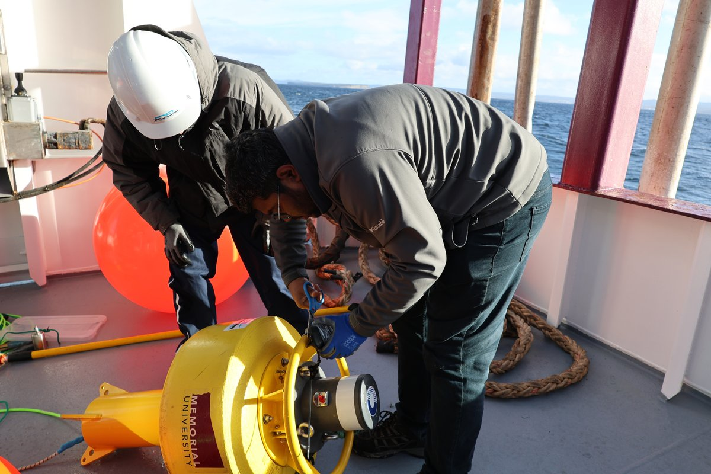
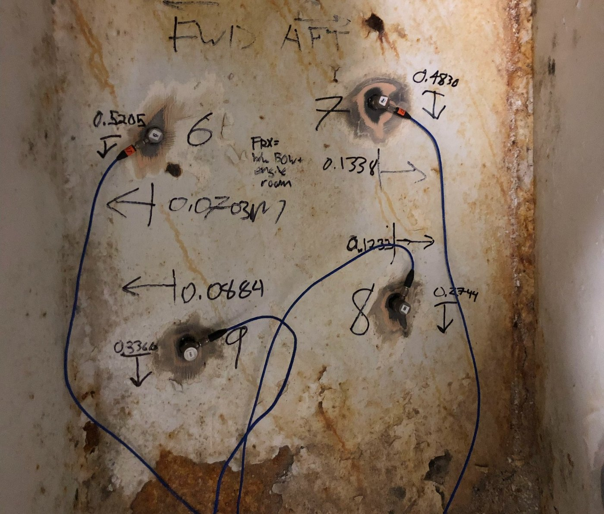
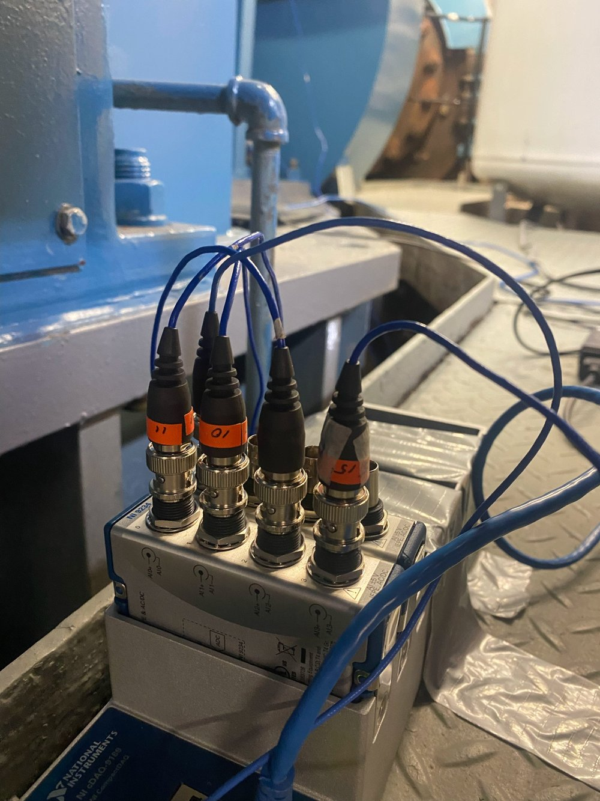

```{=html}
<style>
.facilities-banner { background-image:
  linear-gradient(90deg, rgba(12,35,64,.80) 0%, rgba(12,35,64,.40) 45%, rgba(12,35,64,0) 100%),
  url("images/facilities-banner-buoy-level.jpg");
  min-height: 380px; margin-top: 1rem; margin-bottom: 0; align-items: flex-end; background-position: center 50%; }
.facilities-banner h1 { font-family: 'Inter', sans-serif; font-weight: 300; font-size: 2.6rem; margin: 0; text-shadow: 0 1px 4px rgba(0,0,0,.45); }
@media (max-width: 768px) { .facilities-banner { min-height: 240px; } }
.banner-credit { font-size: .75rem; color: #888; text-align: right; margin-top: .4rem; }
</style>
```

::: {.hero .hero-photo .facilities-banner .column-page}
# Facilities & Tools
:::

::: {.banner-credit .column-page}
Our hydrophone buoy at sea during the 2025 CCGS <em>Henry Larsen</em> campaign. Photo: Paige Bodnar
:::

::: {.intro}
We combine laboratory experiments, numerical models and full-scale measurements at sea. Our lab space is in the Autonomous Ocean Systems Laboratory of the Faculty of Engineering and Applied Science. Most of our equipment was acquired through the Advanced Marine Acoustics Laboratory project, funded by the National Research Council of Canada.

This page lists our main equipment and software, and the facilities we use with our partners.
:::

::: {.theme}
{.lightbox fig-alt="Two researchers on a ship deck fitting a hydrophone to the yellow Memorial University buoy"}

::: {}
## Underwater acoustics

- **Hydrophones**: Ocean Sonics icListen smart hydrophones (24-bit, up to 200 kHz), including self-recording units, and Turbulence Research hydrophones with autonomous recorders.
- **Hydrophone buoy system**: icListen hydrophones on an Ocean Sonics drifting buoy with radio telemetry, so the system can be monitored during measurements. Developed with Ocean Sonics in 2021.
- **Moorings**: a single hydrophone or a vertical array configured to ISO 17208, with OpenSeas subsurface buoys and floats, temperature loggers along the line, and acoustic releases to recover the moorings.
- **Ocean gliders**: we fitted a passive acoustic monitoring system to a Slocum glider of Memorial's fleet, operated by the [Autonomous Ocean Systems Centre (AOSCENT)](https://mun.ca/engineering/research/centres-and-facilities/research-laboratories/ocean-and-naval-architecture-engineering/autonomous-ocean-systems-centre-aoscent/), to measure ship-radiated noise and map the sound-speed profile of the water column.
:::
:::

::: {.theme}
{.lightbox fig-alt="Four accelerometers with blue cables glued to a painted steel hull frame, with hand-written position numbers and distances"}

::: {}
## Vibration and structural dynamics

- **Accelerometers**: more than 25 PCB Piezotronics uniaxial and triaxial ICP accelerometers.
- **Modal testing**: an instrumented impact hammer and a PCB force sensor, and two The Modal Shop electrodynamic shakers with power amplifiers.
- **Shaftline measurements**: strain-gauge rosettes with wireless LORD MicroStrain telemetry to measure shaft torque and torsional vibration on rotating shafts, and Brüel & Kjær laser tachometers for shaft speed. This is the system we use on board icebreakers to record ice–propeller interaction loads.
:::
:::

::: {.theme}
. Click to enlarge.](images/facilities-dodecahedron.jpg){.lightbox fig-alt="Dodecahedron loudspeaker on a tripod and a microphone on a stand inside a compartment of a fishing vessel"}

::: {}
## Airborne noise and occupational exposure

- **Sound level meter**: Larson Davis SoundAdvisor 831C, with calibrator and measurement microphones.
- **Noise dosimeters**: six Brüel & Kjær Type 4448 personal noise dosimeters for crew exposure surveys.
- **Sound source**: omnidirectional dodecahedron source with amplifier, for room acoustics and sound insulation measurements.
- **Hearing protection kit**: earplugs and earmuffs of different types, to study protection in noisy workplaces.
:::
:::

::: {.theme}
{.lightbox fig-alt="Grey NI 9234 data acquisition module with four labelled BNC cables, on a CompactDAQ chassis in an engine room"}

::: {}
## Data acquisition

- National Instruments CompactDAQ systems (up to 8-slot chassis, 24-bit sound and vibration modules) and NI FieldDAQ rugged units for measurements at sea, with ruggedized laptops for field work.
:::
:::

::: {.theme}
. Click to enlarge.](images/fe-superyacht-bending.png){.lightbox fig-alt="Finite element model of a superyacht showing the deformed shape of the hull in its vertical bending mode, coloured by displacement"}

::: {}
## Numerical modelling

- **MSC Nastran and the MSC Software suite**: finite element models of ship structures for modal, forced-response and structure-borne noise analysis.
- **COMSOL Multiphysics**: coupled structural-acoustic analysis with the finite element and boundary element methods, and ray tracing for sound propagation.
- **Statistical energy analysis (SEA)**: models of airborne and structure-borne noise transmission between the spaces of a ship, to predict noise levels on board and test noise control treatments at the design stage.
- **LS-DYNA**: transient and impact analysis, including ice–structure interaction.
- **ANSYS**: finite element and multiphysics analysis.
- **In-house codes** in MATLAB and Python for signal processing, source-level estimation, propagation loss modelling, torsional vibration of shaftlines and uncertainty analysis.
:::
:::

::: {.theme}
. Click to enlarge.](images/software-shaftline-schematic.png){.lightbox fig-alt="Schematic of a ship propulsion shaftline from propeller to engine, with inset plots of the ice-induced torque impact load, the shaft torsional response and the engine torque-speed characteristic"}

::: {}
## Software

- **Shafting torsional vibration tool**: our codes for the torsional vibration analysis of propulsion shaftlines, including ice–propeller interaction loads, developed over several projects with ABS. 
  <!-- Add the link to the repository here when the tool is released. -->
:::
:::

::: {.theme}
::: {}
:::

::: {}
## Partner facilities

- **Towing tank**, Memorial University: model-scale tests of propeller-induced hull pressures and vibration, and of underwater noise from propellers.
- **NRC Ocean, Coastal and River Engineering (OCRE)**, St. John's: towing tank and cavitation tunnel. We are working with NRC to upgrade the cavitation tunnel to measure propeller noise.
- **SMART laboratory** (Smart Materials Additive-manufacturing Research Technologies), Memorial University, led by Dr. Ahmed Elruby: metal additive manufacturing of acoustic black holes and propeller models, with mechanical and non-destructive testing.
- [ShipNVL – Ship Noise & Vibration Laboratory](https://shipnvl.units.it), University of Trieste (Italy): our long-standing partner lab, with joint projects, co-supervised students and shared experimental work on acoustic black holes and metamaterials.
:::
:::
