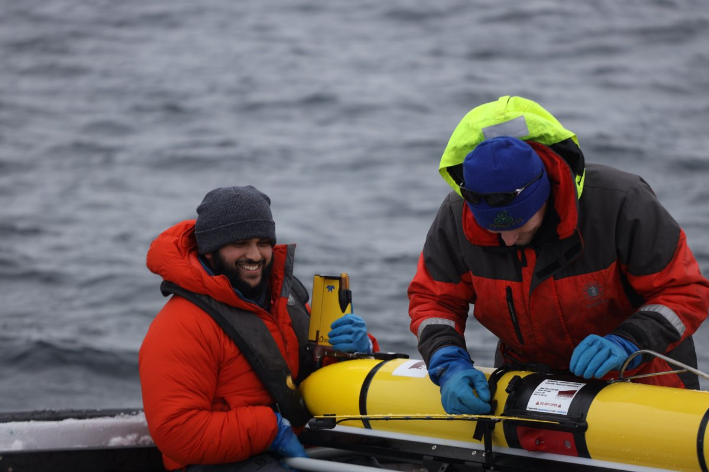
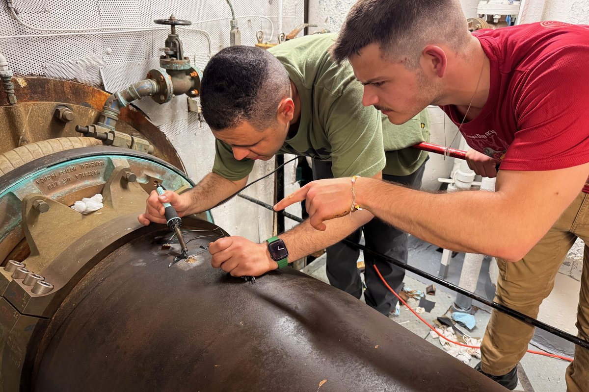
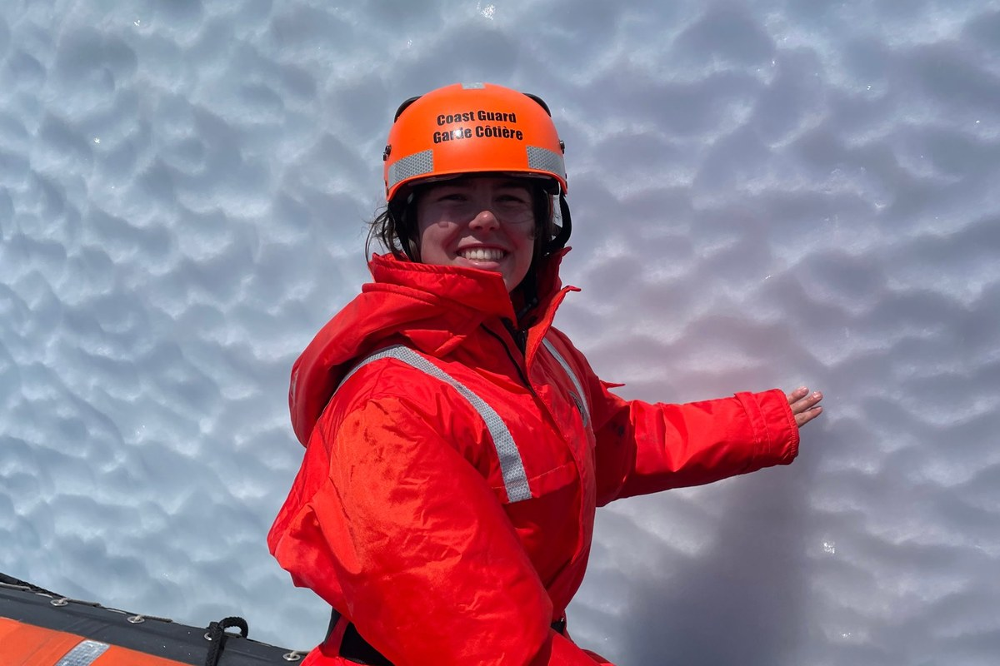
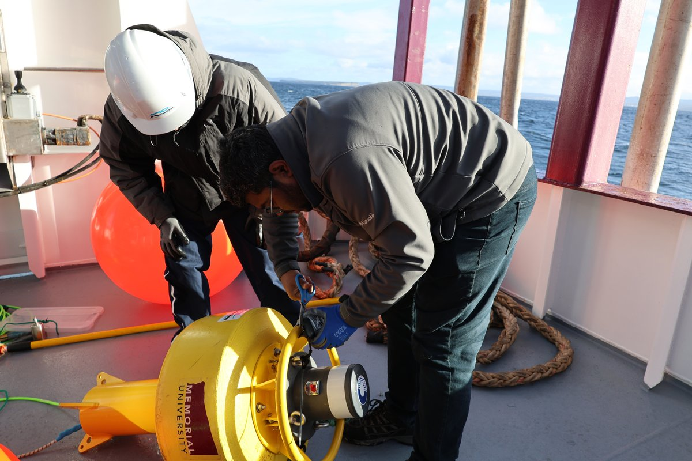

```{=html}
<script type="application/ld+json">
{
  "@context": "https://schema.org",
  "@type": "ResearchOrganization",
  "name": "Marine Sound and Vibration Lab",
  "alternateName": ["MSVL", "Marine Sound and Vibration Laboratory"],
  "description": "Research lab at Memorial University of Newfoundland studying noise and vibration of ships and marine structures: underwater radiated noise, onboard noise and vibration, ice-induced vibration and noise and vibration control by design.",
  "parentOrganization": {
    "@type": "CollegeOrUniversity",
    "name": "Memorial University of Newfoundland",
    "department": "Department of Ocean and Naval Architectural Engineering",
    "url": "https://www.mun.ca"
  },
  "founder": {"@type": "Person", "name": "Lorenzo Moro", "jobTitle": "Associate Professor"},
  "address": {"@type": "PostalAddress", "streetAddress": "240 Prince Philip Drive", "addressLocality": "St. John's", "addressRegion": "NL", "postalCode": "A1B 3X5", "addressCountry": "CA"},
  "knowsAbout": ["ship acoustics", "underwater radiated noise", "ship vibration", "ice-induced vibration", "occupational noise exposure", "noise and vibration control"]
}
</script>
```

```{=html}
<div class="mvl-hero">
  <div class="mvl-eyebrow">MARINE</div>
  <div class="mvl-title">Sound and Vibration Lab</div>
  <div class="mvl-sub">Memorial University of Newfoundland · Department of Ocean and Naval Architectural Engineering</div>
</div>
```

```{=html}
<style>
.hero-photo { background-image:
  linear-gradient(90deg, rgba(12,35,64,.80) 0%, rgba(12,35,64,.45) 55%, rgba(12,35,64,.05) 100%),
  url("images/hero.jpg"); }
</style>
```

::: {.hero .hero-photo}
<!-- Previous banner text (vision statement), kept in case you want it back:
Ships and marine structures that are quiet and free of harmful vibration by design, for the people who work on and around them, for the integrity of the structure, and for the ocean.
-->
We study and control noise and vibration in ships and marine structures, for the people on board, the integrity of the structure and the ocean.
:::

::: {.grid .photo-row}
::: {.g-col-12 .g-col-md-4}
{fig-alt="Two researchers preparing an ocean glider in a boat before deployment"}
:::
::: {.g-col-12 .g-col-md-4}
{fig-alt="Installing strain gauges on a propeller shaft"}
:::
::: {.g-col-12 .g-col-md-4}
{fig-alt="Master's student Paige Bodnar touching an iceberg from a Coast Guard fast rescue boat"}
<!-- previous photo: {fig-alt="Assembling the hydrophone buoy on deck"} -->
:::
:::

::: {.intro}
We develop the methods engineers need to design ships and marine structures with less noise and vibration. We combine full-scale measurements at sea, including in ice, with laboratory experiments and numerical models to understand how noise and vibration are generated, transmitted through structures and radiated into the ocean. We turn that understanding into design methods and noise and vibration control solutions, and into the evidence that standards and regulations rely on.

The lab is led by , Associate Professor in the Department of Ocean and Naval Architectural Engineering at Memorial University of Newfoundland.
:::

## Recent highlights

::: {.highlights}
<!-- Keep 3 to 5 items. Newest first. -->
- **November 2026** — Paige Bodnar named a Fellow of the School of Graduate Studies.
- **July 2026** — New paper in *Ocean Engineering* comparing ISO 17208-3 shallow-water source levels with deep-water references.
- **July 2025** — Arctic measurement campaign aboard CCGS *Henry Larsen*, St. John's to Iqaluit.
- **Now recruiting** — PhD positions starting September 2027. See [Join Us](join.qmd).
:::
