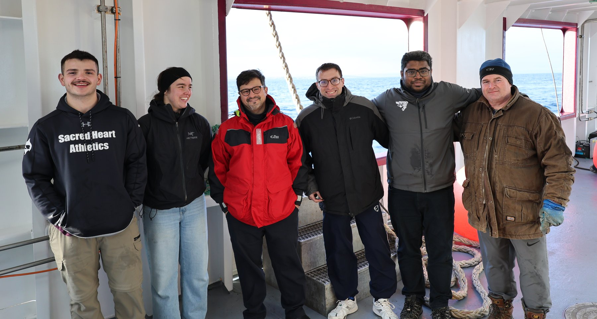

```{=html}
<style>
.join-banner { background-image:
  linear-gradient(90deg, rgba(12,35,64,.80) 0%, rgba(12,35,64,.40) 45%, rgba(12,35,64,0) 100%),
  url("images/join-banner-campus.jpg");
  min-height: 340px; margin-top: 1rem; margin-bottom: 0; align-items: flex-end; background-position: center 60%; }
.join-banner h1 { font-family: 'Inter', sans-serif; font-weight: 300; font-size: 2.6rem; margin: 0; text-shadow: 0 1px 4px rgba(0,0,0,.45); }
.banner-credit { font-size: .75rem; color: #888; text-align: right; margin-top: .4rem; margin-bottom: 3.5rem; }
@media (max-width: 768px) { .join-banner { min-height: 220px; } }
</style>
```

::: {.hero .hero-photo .join-banner .column-page}
# Join Us
:::

::: {.banner-credit .column-page}
Memorial University campus, St. John's. Photo: Memorial University
:::

## Open positions

### PhD positions — start September 2027

We are looking for PhD students to work on underwater radiated noise from ships, propellers and cavitation noise, noise and vibration on board, ice-induced vibration of hulls and shaftlines, and noise control by design, including viscoelastic damping materials, sound insulation and the acoustic design of spaces on board, acoustic black holes and metamaterials. Projects range from numerical modelling and data analysis to laboratory experiments and full-scale measurements at sea. Not every project involves going to sea: we discuss with each student the balance between numerical, laboratory and field work that suits them. Positions are funded for four years, with a competitive stipend.

### Master's students and postdoctoral fellows

We occasionally have openings. Strong candidates with their own funding (for example NSERC, Mitacs or scholarships from their home country) are always welcome to get in touch.

### Undergraduate students

Memorial students interested in co-op work terms or honours projects can email us at any time.

{.lightbox fig-alt="Six people, students and researchers of the lab, smiling on the deck of a vessel with the sea behind them"}

## Who we're looking for

- A degree in naval architecture, mechanical, ocean or acoustical engineering, physics, mathematics or a related field
- Solid foundations in mathematics and mechanics or physics. No previous experience in acoustics or vibration is needed: most of our students learn it here
- Some programming experience, in any language (for example Python, MATLAB, C/C++ or Fortran)
- For projects with fieldwork, willingness to spend time on board working vessels
- Good communication skills in English, written and spoken
- Curiosity for new knowledge, motivation for research and a willingness to learn subjects outside your own training

Experience with numerical modelling (for example finite element methods), laboratory testing or field measurements is an asset, not a requirement. We value different backgrounds: our students have come from engineering, physics and mathematics, and they learn from each other.

## How to apply

Email <span class="obf-email" data-u="lmoro" data-d="mun.ca" data-s="PhD application">lmoro [at] mun.ca</span> with the subject line "PhD application – [your name]" and attach, as a single PDF:

1. A CV, including publications if any
2. Transcripts of your degrees (unofficial copies are fine)
3. A short statement (one page at most) on which of our research themes interests you and why

We read every application but can reply only to shortlisted candidates. Successful candidates will also apply formally through Memorial's [School of Graduate Studies](https://www.mun.ca/sgs/), and must meet its admission requirements, including the [English proficiency requirements](https://www.mun.ca/university-calendar/school-of-graduate-studies/school-of-graduate-studies/4/1/#4.1.5) for applicants whose previous degrees were not taught in English.

## Living in St. John's

{fig-alt="Colourful row houses in downtown St. John's" .living-photo}

St. John's is the capital of Newfoundland and Labrador, a small city of about 250,000 people in the wider area, on the Atlantic coast. The campus is close to downtown and a short drive from the airport, with direct flights to Toronto, Montreal, Halifax and, in season, Europe.

- **Housing.** Most graduate students rent off campus, close to the university. Memorial also has graduate residences on campus, including family units.
- **Outdoors.** The East Coast Trail, Signal Hill and Cape Spear are on the city's doorstep, and you can watch icebergs and whales in spring and summer.
- **Climate.** Winters are milder than in most of Canada but long, windy and snowy, and spring can be foggy. Good rain gear matters more than a heavy parka.
- **Community.** Memorial has a large international graduate community, and its Internationalization Office helps new students with permits, health coverage and settling in.

**Useful links**

- Memorial University: [Graduate life](https://mun.ca/become/graduate/graduate-life/) · [Graduate housing](https://mun.ca/become/graduate/graduate-life/graduate-housing) · [Cost of living](https://www.mun.ca/become/graduate/tuition-fees-and-funding/cost-of-living/) · [International graduate students](https://www.mun.ca/become/graduate/international-students)
- St. John's: [Destination St. John's](https://destinationstjohns.com) · [Newfoundland and Labrador Tourism](https://www.newfoundlandlabrador.com/top-destinations/st-johns) · [City of St. John's](https://www.stjohns.ca/about-st-johns/visit-st-john-s/)
