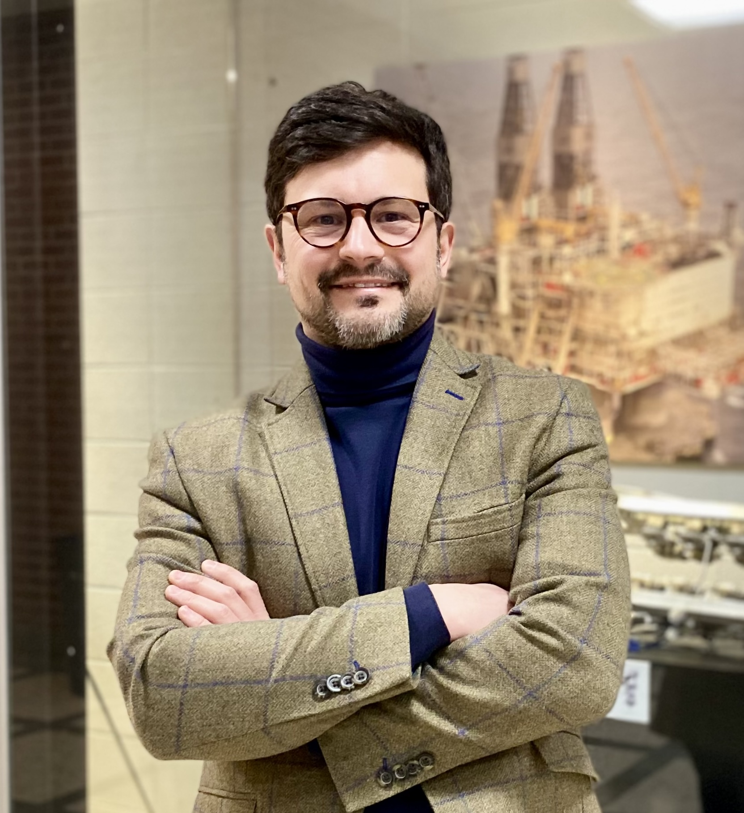
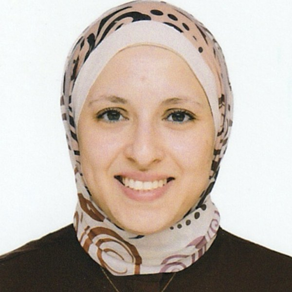
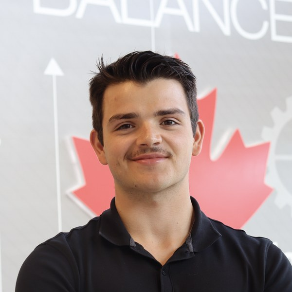

```{=html}
<style>
.people-banner { background-image:
  linear-gradient(0deg, rgba(12,35,64,.80) 0%, rgba(12,35,64,.35) 22%, rgba(12,35,64,0) 40%),
  url("images/team-v2.jpg");
  min-height: 400px; margin-top: 1rem; align-items: flex-end; background-position: center 25%; }
.people-banner h1 { font-family: 'Inter', sans-serif; font-weight: 300; font-size: 2.6rem; margin: 0; text-shadow: 0 1px 4px rgba(0,0,0,.45); }
@media (max-width: 768px) { .people-banner { min-height: 260px; } }
.people-banner { margin-bottom: 5rem; }  /* = credit line (.4rem + ~1.1rem) + 3.5rem, as on the other pages */
#quarto-document-content h2 { margin-top: 4rem; }
</style>
```

::: {.hero .hero-photo .people-banner}
# People
:::


<!--
HOW TO ADD A PERSON: copy one block that starts with ::: {.g-col-6 .g-col-md-3 .person}
and ends with :::, paste it below the others, and change the photo, name and text.
Photos go in the images folder, square, about 600 x 600 pixels.
-->

## Principal investigator

::: {.grid}
::: {.g-col-6 .g-col-md-3 .person}
{fig-alt="Lorenzo Moro"}

[Dr. Lorenzo Moro]{.name}<br>
[Associate Professor, Ocean and Naval Architectural Engineering]{.role}
:::
:::

## PhD students

::: {.grid}
::: {.g-col-6 .g-col-md-3 .person}
{fig-alt="Md Saiful Islam"}

[Md Saiful Islam]{.name}<br>
[Estimating Ship-Radiated Underwater Noise Under Realistic Operational and Environmental Conditions: A Full-Scale Experimental Study]{.role}
:::

::: {.g-col-6 .g-col-md-3 .person}
{fig-alt="Alia Sayed"}

[Alia Mohamed Fathy Sayed]{.name}<br>
[Optimization of acoustic black holes for marine applications]{.role}
:::
:::

## Master's students

::: {.grid}
::: {.g-col-6 .g-col-md-3 .person}
{fig-alt="Paige Bodnar"}

[Paige Bodnar]{.name}<br>
[Underwater radiated noise from ships navigating in ice-covered waters]{.role}
:::

::: {.g-col-6 .g-col-md-3 .person}
{fig-alt="Isaac Burke"}

[Isaac Burke]{.name}<br>
[Hull vibrations from ship–ice interaction and propeller ice milling]{.role}
:::

::: {.g-col-6 .g-col-md-3 .person}
{fig-alt="Sarah McGuire"}

[Sarah McGuire]{.name}<br>
[Identification of non-AIS vessels using machine learning]{.role}
:::
:::

## Alumni

### Postdoctoral fellows and PhD graduates

| Name | Role | Project or thesis | Now |
|---|---|---|---|
| Jacopo Fragasso | PhD 2023; postdoc 2023–2026 | Structure-borne noise of marine diesel engines: transfer-path analysis of onboard transmission | Researcher, National Research Council of Italy (CNR) |
| Alireza Jahanbakhsh | PhD 2025 | Experimental and numerical model testing of propeller-induced hull vibrations | Structural Designer, Robert Allan Ltd. |
| Khaled Mohsen Helal | PhD 2024; postdoc 2024–2025 | Evaluating the performance of ocean glider technology to characterize ship-radiated underwater noise | Engineer II, Noise and Vibration, American Bureau of Shipping |
| Giovanni Rognoni | PhD 2024 (co-supervised, University of Trieste) | Improving ship-acoustic footprint through acoustic black hole metastructure hull | Postdoctoral Fellow, University of Trieste |
| Alessandro Zambon | PhD 2022 | Transient torsional vibration analysis of polar-class propulsion shafting systems under ice–propeller interaction | Naval Architect and Marine Engineer, Nevesbu, The Netherlands |
| Ridwan Hossain | PhD 2021 (co-supervised) | Modelling dynamic ice–structure interaction based on high-pressure zone behaviour | Software Developer, Bluedrop ISM |
| Giorgio Burella | PhD 2020 | Long- and short-term solutions for mitigating hazardous noise exposure on board small-scale fishing vessels of Newfoundland and Labrador | Manager of R&D, Robert Allan Ltd. |
| Kevin Hedges | Postdoc 2016–2017 | Improving fishing safety in Newfoundland and Labrador | Professional Industrial Hygienist |

### Master's graduates

| Name | Year | Thesis | Now |
|---|---|---|---|
| Fatima Hassan Hodroj | 2023 (co-supervised) | Seafarer perceptions and attitudes toward occupational noise exposure and its health impacts | Research Assistant, Memorial University |
| Muhammad Sabah Ud Din Ersum | 2023 (co-supervised) | Investigating work processes to manage noise exposure for crew members on board fishing vessels | Acoustics Consultant, SLR Consulting |
| Md Saiful Islam | 2021 | Measurements of underwater radiated noise from non-cavitating propellers in an atmospheric towing tank | PhD student in the lab |
| Kareem Wael Al-Taiby | 2021 | Propeller-induced vibration: experimental tests in an atmospheric towing tank | — |
| Andrew Greenham | 2020 (co-supervised) | An accelerometer-based approach to hull monitoring beyond the elastic regime | Naval Architect, Adaptive Marine Solutions |
| Jonathan Stone | 2020 | Occupational noise exposures in aquaculture: assessment and mitigation strategy | Medical student, Memorial University |
| Mohamed Auf | 2020 | Hull vibration analysis of a small multi-purpose fishing vessel from Newfoundland and Labrador | Business Intelligence Consultant, Cenovus Energy |
| Md. Mahmudul Hasan | 2019 | Experimental characterization of viscoelastic materials for marine applications | Naval Architect, Seaspan ULC |
