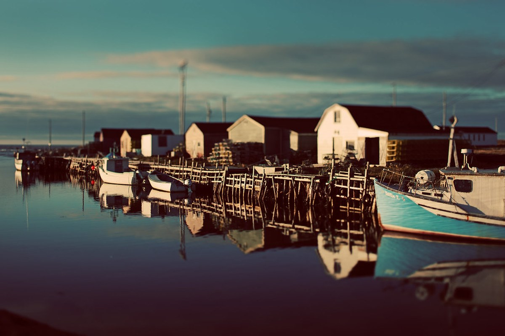
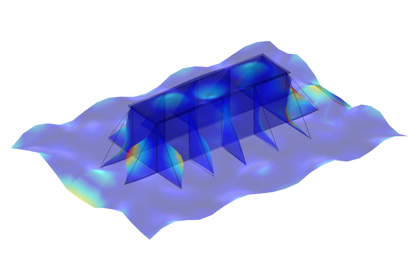
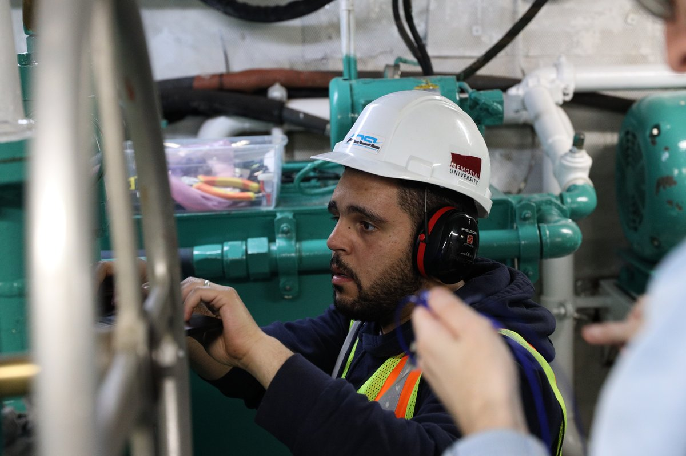
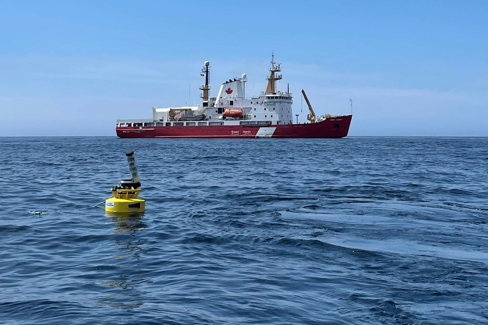
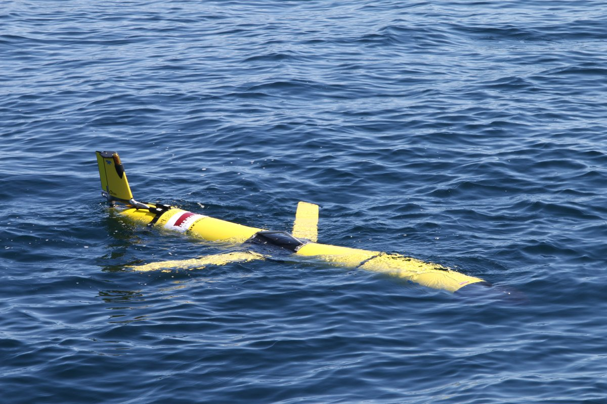
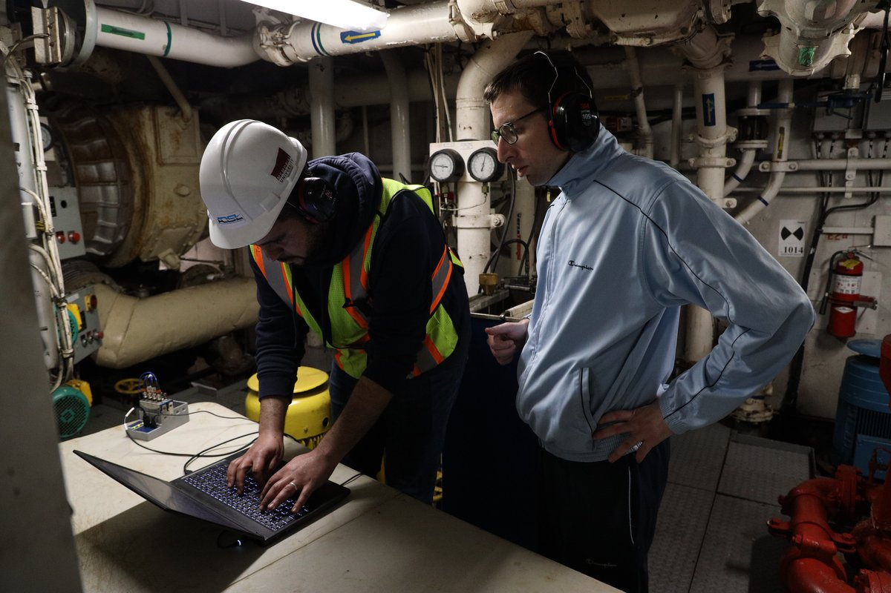
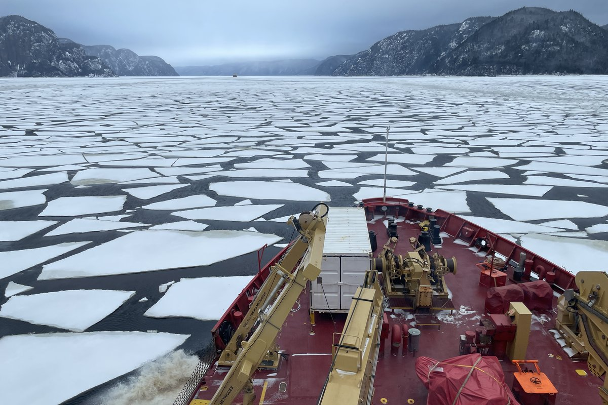
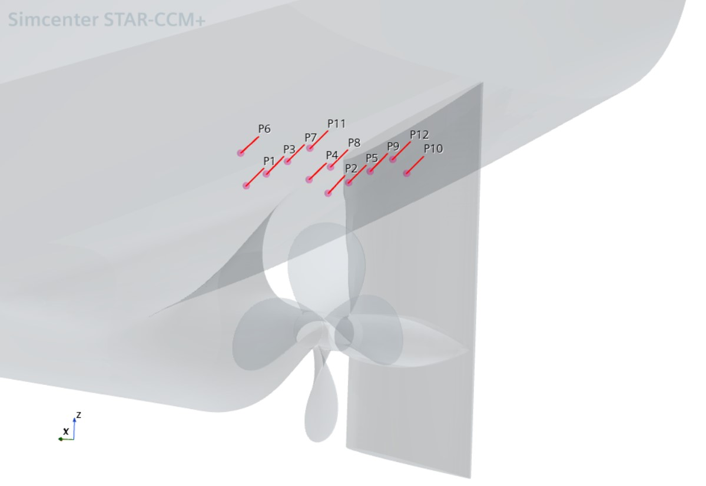

```{=html}
<style>
.research-banner { background-image:
  linear-gradient(90deg, rgba(12,35,64,.80) 0%, rgba(12,35,64,.40) 45%, rgba(12,35,64,0) 100%),
  url("images/research-banner.jpg");
  min-height: 300px; margin-top: 1rem; margin-bottom: 0; background-position: center 85%; }
.research-banner h1 { font-family: 'Inter', sans-serif; font-weight: 300; font-size: 2.6rem; margin: 0; text-shadow: 0 1px 4px rgba(0,0,0,.45); }
.theme { grid-template-columns: 1.15fr 1fr; gap: 2rem; }
@media (max-width: 768px) { .theme { grid-template-columns: 1fr; } }
.banner-credit { font-size: .75rem; color: #888; text-align: right; margin-top: .4rem; }
.intro { max-width: 760px; margin: 3.5rem auto 4.5rem; font-size: 1.2rem; line-height: 1.6; color: #3a4a5c; text-align: left; }
</style>
```

::: {.hero .hero-photo .research-banner}
# Research
:::

::: {.banner-credit}
CCGS <em>Henry Larsen</em> in sea ice, 2025. Photo: Paige Bodnar
:::

::: {.intro}
Our research follows the energy that ships put into the water, the structure and the people on board. We work in three settings: numerical modelling, laboratory experiments and full-scale measurements at sea. Some projects are mainly numerical, some mainly experimental in the lab, and some take place on board; most combine two of the three.
:::

::: {.theme}
{fig-alt="Fishing stages and boats reflected in a Newfoundland outport harbour"}

::: {}
## Future Ocean and Coastal Infrastructures (FOCI)

From 2020 to 2026 Dr. Moro co-led FOCI with Dr. Paul Foley: a transdisciplinary research program on the infrastructures that safe, sustainable and inclusive coastal communities and ocean industries in Atlantic Canada depend on.

FOCI brought together 65 researchers and 89 partners from engineering, the natural and social sciences and the arts, and trained 81 students and early-career researchers. Its results went beyond academic papers, to a documentary film, a theatre piece and musical compositions. Within FOCI, we worked with colleagues in the Department of Ocean and Naval Architectural Engineering on design for the safety and sustainability of fishing vessels: on-board noise, stability, and a lower carbon footprint. FOCI also co-funded our 2025 Arctic measurement campaign aboard CCGS *Henry Larsen*.

**[Visit the FOCI website → fociresearch.ca](https://fociresearch.ca)**

::: {.projects}
**Projects**

- 2022–2026 · FOCI: Designs for Diversity in Newfoundland and Labrador's Blue Economy (Government of Newfoundland and Labrador)
- 2020–2026 · FOCI: Future Ocean and Coastal Infrastructures (Ocean Frontier Institute, Canada First Research Excellence Fund)
:::
:::
:::

::: {.theme}
{fig-alt="Finite element model of an engine foundation made of longitudinal girders and triangular brackets on a plate, coloured by vibration amplitude"}

<!-- previous photo:  -->

::: {}
## Noise and vibration control by design

Engines, propellers and machinery excite the ship's structure. The resulting vibration can harm comfort, equipment and the structure itself, and it is radiated as noise on board and into the sea. We design, model and test ways to control it: at the source, along the paths it travels through the structure, and in the spaces where people live and work.

Our topics include resilient mounts for marine engines, structure-borne transmission paths, viscoelastic materials and damping treatments, sound insulation of decks and bulkheads (floating floors, double-leaf panels and damped linings), the acoustic design of cabins and crew spaces, and acoustic black holes and metamaterials designed to work on a real hull in water. Most of this work moves from numerical simulation to laboratory testing. It builds on research begun at the [Ship Noise & Vibration Laboratory (ShipNVL)](https://shipnvl.units.it) of the University of Trieste, our partner lab.

::: {.projects}
**Projects**

- 2026–2032 · Passive control of structure-borne noise from marine engines using acoustic black holes (NSERC Discovery Grant)
- 2016–2024 · Prediction of structure-borne noise generated by reciprocating machines on board ships (NSERC Discovery Grant)
- 2016–2019 · Design solutions to mitigate noise and vibration on fishing vessels (Research and Development Corporation NL)
:::
:::
:::

::: {.theme}
{fig-alt="Yellow hydrophone buoy at sea with the Coast Guard icebreaker Henry Larsen in the background"}

::: {}
## Underwater radiated noise from ships

Shipping is the main source of human-made noise in the ocean. We study how ships radiate noise, how to predict it and how reliably it can be measured.

On the computational side, we develop tools to predict the noise radiated by ships and statistical prediction models built from a large dataset of vessels. On the measurement side, we work on shallow-water procedures (ISO 17208-3) and on the uncertainty of source-level estimates, using a buoy-mounted hydrophone system with radio monitoring that we developed with Ocean Sonics.

Our Arctic work is part of Project 2.4, Noise Reduction, of the Clean Arctic Shipping Initiative, carried out in partnership with ICC Canada and Makivvik.

::: {.projects}
**Projects**

- 2024–2031 · Clean Arctic Shipping Initiative, Project 2.4 Noise Reduction (Canada First Research Excellence Fund)
- 2021–2024 · Validation of underwater radiated noise modelling via ship-specific measurements (Transport Canada)
- 2022–2023 · Baseline assessment of underwater radiated noise from shipping in Placentia Bay (Fisheries and Oceans Canada)
:::
:::
:::

::: {.theme}
{fig-alt="An ocean glider at the sea surface"}

::: {}
## Ocean gliders and autonomous monitoring

Autonomous underwater gliders can stay at sea for weeks, collecting data far from any ship. We develop methods to measure the underwater noise radiated by passing ships with gliders, including how to account for the glider's own self-noise and the uncertainty of the measurements.

With the University of Bologna, we are also developing a glider-based device and sampling strategy to monitor nano- and microplastics in seawater. This collaboration received the Canada–Italy Innovation Award in 2022.

::: {.projects}
**Projects**

- 2023–2026 · Sampling nano-plastics with an ocean glider, with the University of Bologna (Memorial University)
- 2018–2023 · Monitoring underwater noise from ships with autonomous gliders (Ocean Frontier Institute)
:::
:::
:::

::: {.theme}
{fig-alt="Noise and vibration measurements in the engine room of CCGS Terry Fox"}

::: {}
## Noise and vibration on board

Seafarers and fish harvesters live and work next to engines, propellers and machinery for weeks at a time. We assess noise and vibration exposure on fishing vessels, at aquaculture sites and on research and Coast Guard ships. We measure personal exposures over full work shifts, map noise levels across vessels and facilities, identify the machinery and tasks that drive exposure, and recommend hearing protection suited to each task. We also study how crews perceive and manage that exposure.

We also develop computational tools, including statistical energy analysis models, to predict noise levels on board at the design stage and to find the dominant transmission paths, so that exposure can be reduced before a ship is built.

::: {.projects}
**Projects**

- 2018–2023 · Noise exposure of fish harvesters on large offshore fishing vessels (Ocean Frontier Institute, Module I, with SafetyNet)
- 2017–2024 · Noise exposure of aquaculture workers and solutions to reduce it (Ocean Frontier Institute, Module M, with SafetyNet)
- 2016–2019 · Improving fishing safety in Newfoundland and Labrador (Mitacs)
:::
:::
:::

::: {.theme}
, [CC BY 4.0](https://creativecommons.org/licenses/by/4.0/). Click to enlarge.](images/shaftline-layout.png){.lightbox fig-alt="Diagram of an icebreaker shaft line from propeller to electric motor, showing where the strain gauges, thrust and torque meter and laser tachometer are installed, with sample signals"}

::: {}
## Ice-induced propeller shaft vibration

When a propeller hits ice, the shaft line receives sudden torque peaks that can overload the propulsion system. This work is about the safety and reliability of propulsion machinery on ice-going ships.

We model the torsional vibration of shaft lines with lumped-parameter and finite element methods, measure the shaft-line response on icebreakers in operation, and use the measurements to estimate the loads from ice–propeller interaction. Our torsional vibration codes support the design and classification of ice-class shafting.

::: {.projects}
**Projects**

- 2016–2024 · Ice-induced propeller shaft transient torsional vibration and on-board noise, Phases 1–3 (American Bureau of Shipping; Phase 3 with InnovateNL)
:::

:::
:::

::: {.theme}
{fig-alt="The bow of the Coast Guard icebreaker Amundsen breaking through ice floes"}

::: {}
## Ice-induced hull vibration

Ice impacts on the hull, and vibration transmitted from the propeller and shaft line, make the hull vibrate. This affects comfort on board, the performance of equipment and the fatigue life of the structure.

We model ice-induced hull vibration and the way vibration travels from the shaft line into the hull, and we validate the models with full-scale measurements from icebreakers in operation. We have also worked on models of dynamic ice–structure interaction.

::: {.projects}
**Projects**

- 2023–2025 · Safe operation of light ice class ships in Arctic waters (American Bureau of Shipping, Mitacs)
- 2018–2022 · Ship design and operation for harsh environments (Government of Newfoundland and Labrador)
:::
:::
:::

::: {.theme}
{.lightbox fig-alt="Simulation model of a propeller and rudder behind the hull of a bulk carrier, with twelve pressure probes marked on the hull above the propeller"}

::: {}
## Propellers and cavitation noise

The propeller is often the loudest source on a ship, and in ice it also carries the highest loads. Our newest line of work brings these two problems together.

We have measured the noise and vibration of model propellers in a towing tank. With the National Research Council of Canada, we are now upgrading a cavitation tunnel to measure propeller noise, and with Memorial's additive manufacturing laboratory we are 3D-printing metal propellers to test new designs quickly.

::: {.projects}
**Projects**

- 2024–2029 · Smart Materials Additive-manufacturing Research Technologies, SMART (Energy Research and Development NL)
- 2018–2024 · Prediction of propeller-induced noise and hull vibration, PINOV (Transport Canada, National Research Council, InnovateNL)
:::
:::
:::

## Beyond ships

The same methods apply elsewhere. With orthopedic surgeons at Memorial, we are studying why operating rooms are so noisy and how to reduce it.

::: {.projects}
**Projects**

- 2026–2027 · Mitigating noise exposure in the orthopaedic operating room (Newfoundland and Labrador Health Research Fund)
:::
